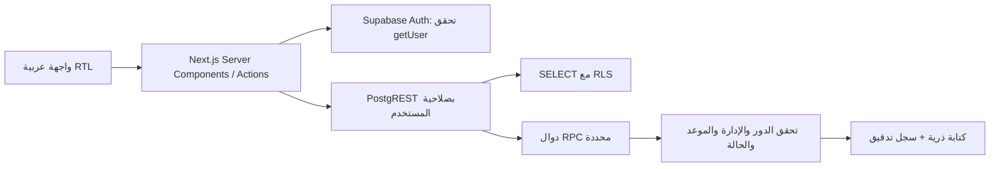

# البنية وقواعد البيانات

لا يوجد service-role في التطبيق. المصادقة تعتمد cookies بـ HttpOnly/SameSite=Lax، وSecure عند التشغيل الإنتاجي. يُحدّث proxy الجلسة، وتتحقق كل عملية من هوية المستخدم لدى Auth بدل الثقة بالمحتوى المحلي للـ cookie. عمليات الكتابة Server Actions مع تحقق Origin المدمج في Next.js، ثم تحقق مستقل داخل PostgreSQL لمنع تجاوز الواجهة عبر API.

## الصلاحيات

| الدور | القراءة | الكتابة |
|---|---|---|
| مدير المديرية | كل الإدارات والنسخ والتدقيق | مراجعة/اعتماد/إعادة فتح، إصدارات البرامج، أدوار الحسابات |
| مشاهد المديرية | البيانات المرسلة والمؤشرات والمستهدفات واللقطات المتاحة | لا توجد صلاحية تغيير البلاغات أو المستهدفات أو الأدوار |
| مدخل بيانات الإدارة | إدارته فقط، ومسوداتها وبلاغاتها ومستهدفاتها | حفظ/إرسال مسودة، اقتراح مستهدف، تجهيز استيراد، لقطة لإدارته فقط |
| غير مصادق / بلا profile | لا بيانات تطبيق | لا شيء |

جميع الجداول عليها RLS. تُسحب صلاحيات INSERT/UPDATE/DELETE من authenticated وanon؛ لا تعتمد الحماية على إخفاء الأزرار. دوال SECURITY DEFINER تستخدم `search_path=''` وأسماء مؤهلة، وتُسحب صلاحية استدعاء المساعدات الداخلية. لا تثق الدوال بـ user_metadata أو دور يمرره المستخدم. تظل صلاحيات مالك قاعدة البيانات وخدمة Supabase الإدارية ضمن حدود الثقة وتتطلب ضبطًا تشغيليًا.

## البلاغات

- مفتاح البلاغ: الإدارة + العام + أسبوع الأحد. قطاعا العام والأزهري ضمن بلاغ واحد وبصفوف منفصلة.
- البرنامج/القطاع/الصف لا يتكرر داخل النسخة، حتى عند محاولة مزج نسخ مختلفة للبرنامج.
- `screened` هو المفحوصون الجدد في ذلك الأسبوع. النتائج في `findings` لا تتجاوز كل منها المفحوصين، وقد تتداخل؛ لا يُستنتج عدد أطفال مختلفين بجمعها.
- من `draft` إلى `provisional`، ثم `approved` أو `needs_correction`. إعادة الإرسال مسموحة للتصحيح قبل الإغلاق/بعد إعادة الفتح.
- `weekly_submissions.official_revision_id` يحدد نسخة رسمية واحدة. عند اعتماد تعديل، تصبح القديمة `superseded` وتبقى محفوظة، ويستبدل المؤشر داخل transaction.
- قفل صف البلاغ أثناء الحفظ/المراجعة يمنع تعارض انتقالات الحالة. unique index يمنع أكثر من نسخة نشطة. لا توجد optimistic concurrency لمنع استبدال تعديلين متزامنين على المسودة نفسها؛ تحتاج مراجعة قبل الاستخدام المتزامن المكثف.
- الموعد يحسب في PostgreSQL بـ `Africa/Cairo`: الأحد التالي 16:00. عند الموعد نفسه يغلق التعديل. مدير المديرية يستطيع إعادة الفتح بسبب إلزامي لمدة لا تزيد على 7 أيام، مع سجل تدقيق. لا يعتمد ذلك على ساعة المتصفح.

## البرامج والأعوام

الإصدارات append-only. الصفوف والمؤشرات مربوطة ببرنامج/عام/إصدار محدد. في 2026–27 الفحص الشامل محصور في kg1/primary1/primary4/preparatory1/secondary1، وvision في kg2 وثلاثة مؤشرات الإبصار. تعطيل vision في عام تالٍ لا يعدل تاريخ العام السابق. المسودات على إصدار قديم تحتاج إعادة حفظ قبل الإرسال؛ النسخ المعتمدة لا يعاد تفسيرها وفق برنامج أحدث.

قائمة مؤشرات الفحص الشامل المرجعية الأولية تحتاج تأكيد المديرية؛ لا توجد دعوى مطابقة لقالب الوزارة. يُدار العام وبرامجه من شاشة البرامج، وتاريخ التعطيل محفوظ بإصدار جديد.

## المستهدفات والحساب

- المفتاح المستقل: إدارة + عام + برنامج + قطاع + صف.
- `proposed` لا يدخل الحساب الرسمي. الاعتماد يستبدل المستهدف النافذ ويحفظ القديم وتاريخ النفاذ. لا تُجمع نسخ المستهدف أو الأسابيع.
- إنجاز الفترة = المفحوصون خلال الأسابيع المختارة ÷ المستهدف السنوي النافذ. اختيار نهاية الفترة يستخدم نسخة المستهدف النافذة بنهاية السبت لذلك الأسبوع بتوقيت القاهرة. بدون نهاية محددة يُستخدم آخر اعتماد نافذ.
- الرسمي يأخذ المؤشر الرسمي فقط، والأولي يأخذ نسخة `provisional` المنتظرة فقط؛ لا يُجمع الاثنان ضمنيًا.
- الواجهة تفصل البرنامج افتراضيًا؛ القطاع الافتراضي عام. الجمع بين العام والأزهري يحتاج اختيارًا صريحًا. لا يدخل vision في مقام comprehensive.
- قراءة البيانات على صفحات محددة مع حد إجمالي صريح؛ تجاوز الحد يوقف التقرير بدل عرض إجمالي ناقص. يلزم نقل التجميع للخادم وفهارس/ترشيح أوسع قبل أحجام تشغيلية كبيرة.

## التقارير المحفوظة والتصدير

`report_snapshots` يحفظ مصادر التقرير ومرشحاته في لقطة ثابتة من قاعدة البيانات عبر RPC مصرح، لا payload يرفعه العميل. اللقطة لا تتغير عند اعتماد بلاغ أو مستهدف لاحقًا. يمكن لمدير المديرية حفظ لقطة عامة، ومدخل البيانات حفظ لقطة إدارته. المشاهد يقرأ/ينزّل اللقطات المتاحة فقط. الوصول لـ snapshot UUID لا يتجاوز RLS.

CSV تحليلي UTF-8 BOM مع اقتباس الحقول ومعالجة formula injection. لكل صف فحص سجل عدد واحد، ثم سجلات نتائج المؤشرات؛ لا يُكرر المفحوصون في كل مؤشر. لا تجمع سجلات النتائج مع سجلات الفحص. تصدير الوزارة يرجع HTTP 409 حتى تتوفر مطابقة مرجعية موثقة؛ جدول mapping محفوظ كبنية للمراجعة المستقبلية، ولا توجد واجهة تسمح باعتبار مطابقة غير موثقة معتمدة.

## الاستيراد

CSV محدود بالأعمدة aggregate الموثقة، 500 صف، اختيار الإدارة من قائمة موحدة، كشف التكرار والأعداد غير الصالحة والأسبوع/الصف غير الصحيح. التخزين في staging فقط، مع تحقق آخر من catalog في القاعدة. لا يُحفظ النص الخام، ولا تُقبل أعمدة المرضى. المعاينة الحالية تدعم مؤشرات البرامج المرجعية، وتحتاج توسعة مدروسة قبل أي catalog مخصص. لا يوجد اتصال قراءة أو كتابة فعلي بـ Google Sheets، ولا ترحيل تلقائي من staging إلى البلاغات.
